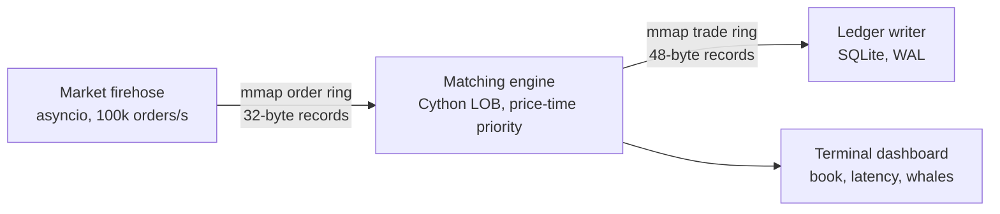

# ChronosMatch ⚡ Zero-Copy High-Frequency Trading Engine


A low-latency **limit order book** written in Python + Cython. Processes share data through
**memory-mapped ring buffers** (no pickling), orders are matched by **price-time priority** in C-level
code (no Python objects, no garbage-collector pauses), every trade is saved to a **SQLite ledger**, and a
live terminal dashboard shows the book, latency and large "whale" orders.

> Internship project - Python Development, Infotact Solutions.

## Why this project
Python is usually dismissed for high-frequency trading: the garbage collector causes latency spikes, the GIL limits
speed, and passing data between processes needs slow serialization (JSON/pickle). ChronosMatch shows how to work
around all three with `mmap`, `struct` and Cython.

## Features
- **Zero-copy IPC:** 32-byte order records in a shared-memory ring buffer (single producer / single consumer, lock-free)
- **Cython matching engine:** price-time priority, partial fills, multi-level sweeps, pre-allocated order pool
- **Latency metrics:** C monotonic clock, p50 / p99 / p99.9 / max per order (histogram, no per-order allocation)
- **Resilient ledger:** trades stream through a second shared-memory ring to SQLite; exactly-once, crash-safe
- **Live dashboard:** curses UI with bid/ask depth, spread, throughput, latency and a red **WHALE** banner
- **Proof tools:** unit + fuzz tests, GC proof, 1M-order IPC audit, ledger audit, benchmark

## Architecture


## Tech stack
| Area | Tools |
|---|---|
| Language | Python 3.9+, Cython 3.x (C extension) |
| IPC | `mmap`, `struct`, shared-memory ring buffers |
| Concurrency | `asyncio` (market feed), `multiprocessing` / `subprocess` |
| Storage | SQLite (WAL mode) |
| UI | `curses` (`windows-curses` on Windows) |
| Testing | `unittest`, fuzz test vs naive reference, `gc` / `sys.getallocatedblocks` |

## Project structure
```
config.py              record layouts and constants
ring_buffer.py         RingBuffer (orders) and TradeRing (trades) on mmap
market_firehose.py     asyncio order generator          order_gen.py   deterministic generator
matching_engine.pyx    Cython limit order book          engine_py.py   pure-Python baseline / fallback
engine_loader.py       picks Cython if built, else Python
engine_runner.py       engine process + dashboard       ledger_writer.py   ring -> SQLite
verify_engine.py       42 unit/fuzz tests               acceptance_tests.py   one check per requirement
ipc_audit.py           1M-order IPC audit               gc_proof.py        no-GC proof
audit_ledger.py        ledger audit                     ledger_report.py   summary + small CSV sample
benchmark.py           Python vs Cython benchmark       REQUIREMENTS.md    requirement -> evidence table
```

## Installation
```powershell
git clone https://github.com/nityashrivastava8/Chronosmatch.git
cd Chronosmatch
python -m venv venv
venv\Scripts\Activate.ps1                      # Linux/macOS: source venv/bin/activate
pip install "cython>=3.0" setuptools
pip install windows-curses                     # Windows only (for the dashboard)
python setup.py build_ext --inplace            # optional: build the Cython engine
```
The Cython build needs a C compiler (Windows: *Build Tools for Visual Studio* with the C++ workload;
Linux: `build-essential`). **Without it everything still runs** on the pure-Python engine, which is the baseline.

## Running
```bash
# one-command demo: engine + 100k orders/s feed + SQLite ledger (press q to quit)
python engine_runner.py --spawn-feed --spawn-ledger --feed-duration 30

# no dashboard (e.g. no curses)
python engine_runner.py --no-ui --spawn-feed --spawn-ledger --feed-duration 10

python audit_ledger.py            # ledger rows == engine trades, no gaps
python ledger_report.py           # ledger summary
python verify_engine.py           # tests
python acceptance_tests.py        # one PASS/FAIL line per requirement
python gc_proof.py                # no Python objects / GC runs while matching (Cython)
python benchmark.py               # writes RESULTS.md
python ipc_audit.py               # 1M orders between two processes vs pickle
```
`trades.db` is created by each run and is not committed (see `docs/sample_trades.csv` for a sample).

## Screenshots
| Live dashboard | Acceptance tests |
|---|---|

 | 


| Ledger audit | Benchmark |
|---|---|

 | 
 

## Results
Measured on my machine (see `RESULTS.md` for the full table; numbers vary by hardware):

| Metric | Pure Python | Cython |
|---|---|---|
| Orders / second | _fill in_ | _fill in_ |
| Engine latency p99 | _fill in_ | _fill in_ |
| Trades dropped / lost | 0 | 0 |

## Scope
**In scope:** shared-memory IPC, limit order book (buy/sell, price-time priority), latency measurement, ledger and
audit, live terminal dashboard, tests and benchmarks.
**Out of scope:** real exchange connectivity (the feed is simulated), order cancel/modify, multiple symbols,
multiple producers/consumers, ClickHouse (SQLite only), production hardening.

## Limitations
- One producer and one consumer per ring; prices limited to 0 - 99,999 ticks.
- End-to-end latency includes time orders wait in the ring while the engine processes a batch.
- Real HFT systems use C++/hardware; this project demonstrates the techniques in Python.

## Future work
Order cancel/modify, multi-symbol books, real market-data adapter, ClickHouse ledger, Prometheus metrics.

## Author
**[Your name]** - Python Development Intern, Infotact Solutions
